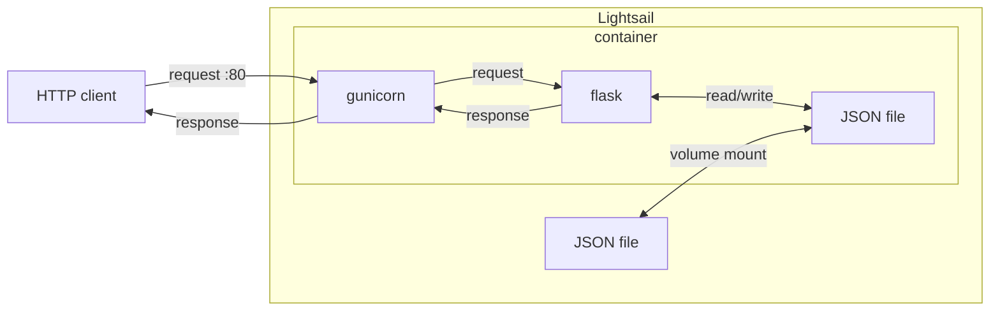
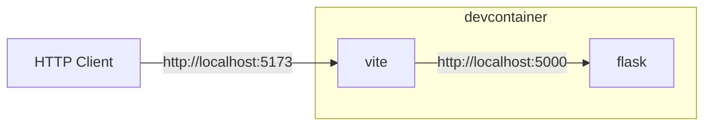

# Happiness アプリ 構想

## 提供するサービス
幸せな暮らしを確立するためのツールを提供する。
具体的には、自分がどうやったら幸せに暮らせるか仮説検証サイクルを回すための仮説・方法の登録、日々の結果の記録、過去の仮説検証過程の振り返り機能を提供する。

## サービス構成

アプリサーバーはfrontendとbackendに分けず、

## 初回セットアップ手順
1. Github repositoryを作成する。
2. Lightsail instanceを作成する。JSON fileの作成は不要(アプリ側で、ファイルがなければ作成する)。
3. OIDC設定をする: IDプロバイダー、IAMロール、IAMポリシーを設定する。

## 2回目以降の運用手順

1. 開発者がアプリの更新内容をmainにpushする。
2. Github actionsがLightsail内のcontainerを自動更新する。
   1. docker imageをビルドし、GHCRにpushする。
   2. Lightsail instanceにSSH接続する。
   3. Lightsailからdocker imageをpullする。

## 開発環境と本番環境の切り替え
開発環境はdevcontainerを用いる。Vite(frontend, HMR) + flask(backend API)

- ホスト側からフロントエンドにアクセスするために、devcontainer内の5173ポートをホストの5173ポートに転送する。

